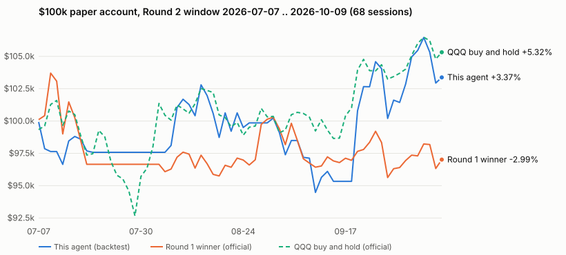

# Convex Sprint — a Builderr Trading Round 2 agent

**What only this entry has:** exposure sized for the window a late Round 2 entry actually gets (13–15 sessions, ranked on raw return), three numeric stop rules, and published odds — from every past 15-session window — of clearing the current top-3 bar, including how often it loses.

In plain words: most 15-session windows end near flat (median 0.0%); about 1 in 4 clear the current #3 bar; about 1 in 10 end 6% or more down.

| Past 15-session windows, 2022-03 .. 2026-10 (simulation) | This agent | QQQ buy and hold |
|---|---|---|
| Beat the current #3 (sham +5.76%, moved with its own beta 0.24 to QQQ) | **25.5%** | — |
| Beat the current #1 (opu +8.54%, moved with its own beta 0.89 to QQQ) | **10.2%** | — |
| Return >= +6% / >= +8.5% | 28.0% / 17.4% | 13.8% / 6.5% |
| Return > −2.99% (Round 1 winner's Round 2 return = the prize bar) | 77.0% | **80.7%** |

So it trades a slightly lower chance of clearing the prize bar for about twice QQQ's chance of a top-3-sized return. `agent.py` is one standard-library file (`import math` only): no network, files, clock, randomness or LLM.

## When is it aggressive, and what forces it to stop?

| State | When (QQQ closes only; "above" = on 2 of the last 3 closes) | Book |
|---|---|---|
| **ATTACK** | QQQ above its 20- and 50-session averages, no brake, 10-session realized vol <= 40%/yr | 3 strongest uptrending large caps x 25% + one 3x sleeve (SOXL when SMH beat QQQ over 21 sessions, else TQQQ) sized to **beta-adjusted gross 1.25** |
| **LEADERS** | QQQ above its 50-session average but not ATTACK | the same 3 leaders x 25%, **no sleeve** (gross 0.75) |
| **CASH** | QQQ not above its 50-session average, **or** a QQQ 5-session drop of 6%+ on any of the last 3 sessions | **all cash** |

Also: below 90% of the $100,000 start the sleeve is off. A held leader stays while it still trends and ranks top 6. Any line above 28% is cut to target; if beta gross passes 1.35, every line is reset. The vol limit rarely binds (QQQ's 10-session vol was 12% on 2026-10-09); it exists for 2020-style spikes. Beta multiples are the challenge's table (3x ETFs = 3, 2x = 2, everything else = 1).

State on the last bar (2026-10-09 close): **ATTACK** — PLTR, MRVL, MSFT at 25% each and SOXL at 16.7%.

## How it compares

| Strategy | How it works | What this entry does differently |
|---|---|---|
| [Round 1 winner](https://github.com/builderr-ai/builderr-trading-round-1-winner/blob/main/round_1_winner_agent.py) | 5 momentum leaders, CASH/NEUTRAL/FULL, QLD/SSO only in FULL, −6%/−10% drawdown taper, 8% trailing stops | 3 leaders + a 3x sleeve for a 15-session window; stops are regime-level, not per name |
| [Template house agent](https://github.com/builderr-ai/builderr-trading-template/blob/main/agent.py) "Forward-Return Rotation Hybrid" | ETFs + mega-caps by 60/20-day momentum, defensive sectors when risk-off, small QLD/SSO overlay, gross <= 1.35 | cash instead of defensive sectors; the leveraged line is 3x and follows the leading index |
| [ANATOMY.md "AI play"](https://github.com/builderr-ai/builderr-trading-template/blob/main/ANATOMY.md) | top 4 of NVDA/AMD/MU/MRVL/AVGO/SMH at 25%, cash when QQQ is below its 100-day average | 20-name universe, 2-of-3 confirmation, 6% crash brake, 3x sleeve |
| [Seed dual momentum](https://github.com/builderr-ai/builderr-trading-template/blob/main/seed_dual_momentum.py) | SPY 60-day gate; top 3 sector ETFs or XLP + XLU; weekly; no leverage | single names and a 3x sleeve; cash when off; daily checks |

## Results (simulation)

**Return** = account value at the last session's close / $100,000 − 1, counted from the first scored session (the board's definition).

All numbers are backtests on daily Yahoo bars (split/dividend adjusted, as the board uses) through `engine/sim.py`, a mirror of the board's `run_bot`: decide on prior closes, fill at the open with 5/10 bps slippage, sells first, buys clamped to cash, 30% per name and 1.5x beta gross, marked at the close. Mirror check: QQQ buy-and-hold over 2026-07-07..10-09 matches the official market curve within 0.07% on every day.

**How much to trust the window odds**
- The 1,144 windows overlap. Non-overlapping blocks (77): P(>= +6%) 31.2% ± 5.3% (one standard error).
- By start year, P(>= +6%): 2022 3.8% · 2023 30.0% · 2024 36.5% · 2025 33.6% · 2026 33.9%. In a falling market the bot sits in cash and rarely reaches the bar.
- Starting in ATTACK (the state on 2026-10-09), past windows cleared +6% 35.7% of the time and −2.99% 71.9%.
- The stock list is the board's 2026 fetch list, which includes later leaders. Without PLTR, MU, MRVL and AVGO: P(>= +6%) 22.6%, P(>= +8.5%) 14.6%.
- "Moved bar" = the entrant's 2026-10-09 return grown by its fitted beta times QQQ's return in the same window; other and late entrants are ignored. A bar model, not a forecast.

**Same period as the Round 1 winner's official Round 2 curve** (2026-07-07 .. 10-09, 68 sessions). In-sample: two churn rules were added after the first version lost here (−4.78%); see `SPEC.md`.



| | Return | Max drawdown |
|---|---|---|
| This agent (backtest) | +3.34% | 7.9% |
| Round 1 winner (official) | −2.99% | — |
| QQQ buy and hold (official) | +5.32% | — |

QQQ alone did better here: the agent was in cash for 25 of the 68 sessions (13 in a row from Jul 20).

**Round 1 window** (16 sessions closing 2026-07-02, where the Round 1 winner made +5.91%): this agent **−6.16%** (QQQ +1.6%). Semis fell 9% on 2026-06-05 and the book lost about 15% that day.

**One account, 2022-03 .. 2026-10** (1,158 sessions, in-sample universe): +438%, 44% a year, max drawdown 25.8%, worst day −15.5%.

**Admission:** the template's own `preview.py` (copied unchanged, MIT) passes — peak gross 1.32x, longest run >= 30% 0 days, worst drawdown 12.7% (`results/preview_template_run.txt`). The same checks in `engine/sim.py::run_admission` pass on two extra stress windows (2022-03..06, 2025-02..05) and on one continuous 2022–2026 run (peak close gross 1.37; one close at 30.3%, limit is 5 in a row). A synthetic +40% overnight gap in the sleeve stays under 1.45 (`tests/test_caps.py`).

**Sensitivity** (vol limit, brake, leader weight, beta target 1.04–1.40, confirmation 2–4 closes, keep-rank 5–7): P(>= +6%) stays between 24.0% and 29.0%. Reviewer ideas that were tested and not adopted (semis cap, SOXL→TQQQ switch, 97% floor, one-day sleeve exit, sleeve vol gate, 30% vol limit) are in `results/variants.jsonl`; none raised both P(>= +6%) and P(> −2.99%).

## Pre-submit checklist (from the challenge page)

| Challenge rule | Where it is checked |
|---|---|
| No `.env` and no API keys committed | `.gitignore`; the agent needs no key |
| `python preview.py` clears the safety bar | `results/preview_template_run.txt` (template preview, unchanged) |
| Every position under the 30% cap; gross under 1.5x | targets 25% / 1.25; `tests/test_caps.py`; replays above |
| No external data for the regime dates (lookahead) | agent imports only `math`; `tests/test_lookahead.py`: future bars scrambled, a recording proxy shows every bar read is before the session, no date literals or clock names, no state carried from a later call |
| Runs with only the bars it is given | `tests/test_contract.py` (missing tickers, bad bars, file copied alone the way `private_agents/` loads it) |

## Run it

```bash
python -m pytest -q                 # 31 tests: contract, caps, lookahead, regime
python preview.py                   # the template's admission preview
python research/fetch_bars.py       # daily bars for the board's 42 tickers (not committed; sha256 in results)
python research/backtest.py         # writes results/backtest.json
python research/variant.py '{"SEMIS_MAX": 2}'   # one rule variant
python research/chart.py            # writes docs/round2_window.svg
```

`SPEC.md` holds the purpose, the success conditions fixed before the first backtest, Given/When/Then cases, and the full change log.

## Limits

- Backtests are simulations on past data; nothing here predicts Oct 2026.
- High variance on purpose: about 10% of past windows lost more than 6.2%; the worst lost 22.6%.
- Stops are regime-level (QQQ), not per stock: one bad semis day can cost 15% before the next decision.
- Caps are checked at daily closes; intraday leverage is not measured (the board is daily).
- Two churn rules were added after the first run and the beta target was lowered twice (`SPEC.md` change log).

`sample_regimes.json.gz` and `preview.py` are from the MIT-licensed builderr trading template. `data/official_round2_*.json` are the board's published numbers (template repo, 2026-10-09). License: MIT.
